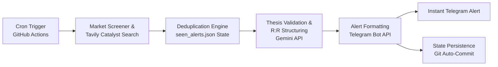

# 🎯 Multibagger Hunter: Autonomous US Equity & Swing Setup Radar

[](https://github.com/riyankhamdani/multibagger-hunter/actions)
[](https://www.python.org/downloads/)
[](LICENSE)

An autonomous, serverless US equity screening and swing-setup alert pipeline engineered to surface asymmetric risk-to-reward opportunities. It filters high-momentum tickers, enriches setups with real-time news catalysts via Tavily Search API, validates thesis fundamentals with Gemini AI, and delivers structured trade execution parameters straight to Telegram.

Powered by Google Gemini API (`google-genai` SDK), Tavily Search API, and scheduled GitHub Actions workflows.

---

## 🏗️ Architecture & Pipeline Flow

The agent executes on a scheduled serverless cron aligned with US market sessions, querying market candidates, fetching real-time catalysts via Tavily, deduplicating tickers against git-persisted state, and dispatching structured risk-reward setups to Telegram.



---

## 🎯 Key Engineering Highlights

- **Real-Time Catalyst Intelligence (Tavily Integration):** Queries live financial news, earnings releases, and sector catalysts via Tavily Search API to filter out technical setups lacking fundamental momentum.
- **Asymmetric Risk-to-Reward Structuring:** Automatically calculates actionable Entry Zones, hard Stop-Loss (SL) levels, and tiered Take-Profit (TP) targets to enforce disciplined position sizing.
- **Resilient Multi-Model Fallback:** Dynamically queries active Gemini models (`gemini-2.5-flash`, `gemini-2.0-flash`, etc.) with exponential backoff to guarantee uninterrupted execution under free-tier rate limits.
- **GitOps State Ledger:** Commits `seen_alerts.json` back to repository state on every cron cycle via `actions-user` to guarantee idempotency and zero duplicate alerts.
- **100% Serverless:** Operates with zero hosting or persistent infrastructure costs.

---

## 📱 Live Sample Output (Telegram Notification)

```text
🎯 MULTIBAGGER HUNTER — SWING SETUP RADAR
====================================

🚀 $LUNR — Intuitive Machines, Inc.
📊 Setup: Post-Pullback Support Reclaim | Catalyst: Lunar Contract Backlog

💵 Execution Parameters:
• Entry Zone : $12.10 – $12.30
• Stop Loss  : $11.44 (-6.5% max risk)
• Target 1   : $14.20 (+16.0%)
• Target 2   : $16.50 (+34.8%)

🧠 AI Thesis:
"Strong institutional accumulation following aerospace contract milestones. Price is consolidating above key moving-average support with favorable R:R (>2.5x) ahead of upcoming mission catalysts."
```

---

## 🛠️ Tech Stack

- **Runtime:** Python 3.11+
- **LLM Reasoning:** Google Gemini API (`google-genai` SDK with auto-model fallback)
- **Catalyst & News Search:** Tavily Search API (`tavily-python` / REST)
- **Orchestration:** GitHub Actions (`agent.yml`)
- **Notification Service:** Telegram Bot API (`requests`)
- **State Store:** Git-persisted JSON (`seen_alerts.json`)

---

## ⚙️ Environment Configuration

Configure the following secrets in GitHub Repository Settings (`Settings -> Secrets and variables -> Actions`):

| Secret Name | Description |
|---|---|
| `GEMINI_API_KEY` | Google AI Studio API Token |
| `TAVILY_API_KEY` | Tavily Search API Token |
| `TELEGRAM_BOT_TOKEN` | Bot API Token from `@BotFather` |
| `TELEGRAM_CHAT_ID` | Telegram User or Channel ID |

---

## 🚀 Local Execution

```bash
# Clone repository
git clone [https://github.com/riyankhamdani/multibagger-hunter.git](https://github.com/riyankhamdani/multibagger-hunter.git)
cd multibagger-hunter

# Install dependencies
pip install -r requirements.txt

# Run screening pipeline
export GEMINI_API_KEY="your-gemini-key"
export TAVILY_API_KEY="your-tavily-key"
export TELEGRAM_BOT_TOKEN="your-bot-token"
export TELEGRAM_CHAT_ID="your-chat-id"

python agent.py
```

---

## ⚠️ Disclaimer
*This project is built for automated market research and technical experimentation purposes only. All alerts, price targets, and risk levels generated by this pipeline do not constitute financial or investment advice.*
